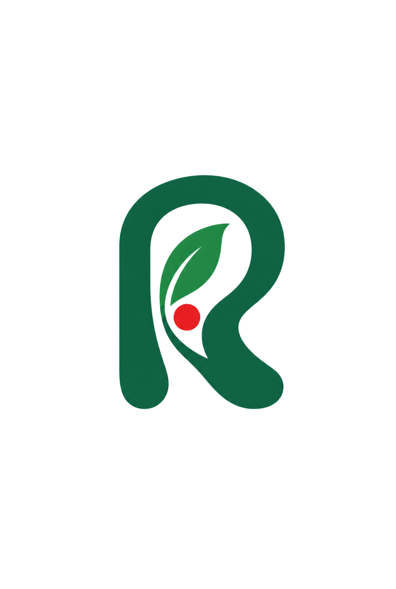

# Rowan UI Core

<p align="center">
  
</p>

<p align="center">
  <strong>Plain-vanilla Web Components design system</strong><br/>
  Custom Elements · Shadow DOM · CSS Tokens · Zero Dependencies
</p>

<p align="center">
  <a href="https://2351labs.github.io/rowan/">📚 Documentation</a> ·
  <a href="https://www.npmjs.com/package/@rowan-ui/core">📦 npm</a> ·
  <a href="CHANGELOG.md">📝 Changelog</a>
</p>

---

## Why Rowan

Rowan is named after the rowan tree (_Sorbus aucuparia_): small, hardy, and easy to recognize without being loud. It grows at edges and in thin soil. The scarlet berries are a detail on the tree, not the tree itself.

That is the brief for this library.

- **Vanilla first.** Custom Elements, Shadow DOM, slots, CSS tokens. No framework runtime in the box.
- **Composition over inheritance.** Public API is attributes, properties, slots, events, and parts. Components nest; they do not subclass each other.
- **Config where reuse matters.** Tables and similar surfaces take data and cell config so the same component can be a checkbox column in one app and a link column in another.
- **Quiet theming.** Primitive → semantic → component tokens. Dark mode is a token swap, not a fork.

The mark is an R with a single berry in the counter. The letter is the product. The berry is the reminder: keep the accent small.

**Current version:** `0.22.0` · **Status:** Pre-1.0 (most components are Stable)

## Quick Start

### Install

```bash
npm install @rowan-ui/core @rowan-ui/icons
```

### Basic Usage

```js
import "@rowan-ui/core/tokens";
import "@rowan-ui/core/tokens/light";
import "@rowan-ui/core/button";
import "@rowan-ui/core/table";

const table = document.querySelector("rowan-table");
table.config = {
  rowId: "id",
  selectable: "multiple",
  columns: [
    { id: "name", header: "Name", sortable: true },
    { id: "role", header: "Role", type: "badge" },
  ],
  rows: [
    { id: "1", name: "Ada", role: "Admin" },
    { id: "2", name: "Alan", role: "Editor" },
  ],
};
```

```html
<rowan-table></rowan-table>
<rowan-button>Save</rowan-button>
```

## Framework Integration

Rowan works seamlessly with all modern frameworks:

### React

```tsx
import { RowanButton } from "@rowan-ui/core/react/button";
import { RowanTable } from "@rowan-ui/core/react/table";

export function App() {
  const [selected, setSelected] = useState([]);
  
  return (
    <RowanTable
      config={config}
      selected={selected}
      onRowanSelect={(e) => setSelected(e.detail.selected)}
    />
  );
}
```

### Vue, Angular, Svelte

See our comprehensive framework integration guides:

- **[React Guide](https://2351labs.github.io/rowan/#react)** - Wrappers, SSR, Next.js
- **[Vue Guide](https://2351labs.github.io/rowan/#vue)** - Property binding, events, refs
- **[Angular Guide](https://2351labs.github.io/rowan/#angular)** - Custom elements schema, bindings
- **[Svelte Guide](https://2351labs.github.io/rowan/#svelte)** - Runes, property bindings

## Components

Rowan ships **109 components** across these categories:

- **Forms & Input** (20) - Text fields, selects, date pickers, rich text editor, validation
- **Data Display** (28) - Tables, virtualization, charts (trend, bar, donut, scatter, heatmap, etc.), KPI cards
- **Actions & Feedback** (10) - Buttons, badges, alerts, progress, toasts
- **Overlays & Menus** (12) - Dialogs, drawers, dropdowns, tooltips, context menus
- **Navigation & Layout** (13) - App layout, tabs, trees, breadcrumbs, pagination
- **Files & Uploads** (3) - Dropzone, file upload with progress

[**View full component catalog →**](https://2351labs.github.io/rowan/#all-components)

## Documentation

Our comprehensive documentation site covers:

- **[Getting Started](https://2351labs.github.io/rowan/#getting-started)** - Installation, first screen, project structure
- **[Framework Integration](https://2351labs.github.io/rowan/#react)** - React, Vue, Angular, Svelte guides
- **[Theming](https://2351labs.github.io/rowan/#theming)** - Token layers, custom themes, design handoff
- **[Bundle Size & Optimization](https://2351labs.github.io/rowan/#bundle-size)** - Tree-shaking, lazy loading, production strategies
- **[Component API Reference](https://2351labs.github.io/rowan/#button)** - Per-component attributes, properties, events, slots, CSS parts
- **[Accessibility](https://2351labs.github.io/rowan/#quality)** - ARIA, keyboard navigation, screen readers

[**📚 Browse full documentation →**](https://2351labs.github.io/rowan/)

## Key Features

### Zero Dependencies

Rowan has **zero production dependencies**. All components share a common foundation, so adding more components has minimal incremental cost.

### Tree-Shakable

Import only what you need:

```js
// Import specific components
import "@rowan-ui/core/button";
import "@rowan-ui/core/table";

// Or import everything (not recommended for production)
import "@rowan-ui/core";
```

### TypeScript Support

Full TypeScript declarations for every component:

```ts
import { RowanTable, type RowanTableConfig } from "@rowan-ui/core/table";

const config: RowanTableConfig = {
  rowId: "id",
  columns: [{ id: "name", header: "Name" }],
  rows: [{ id: "1", name: "Ada" }],
};
```

### Theming

Three-layer token system (primitive → semantic → component) with 6 built-in themes:

```js
import "@rowan-ui/core/tokens";
import "@rowan-ui/core/tokens/light";  // or dark, lagoon, ember, slate, midnight
```

[**Learn more about theming →**](https://2351labs.github.io/rowan/#theming)

## Development

```bash
# Install dependencies
npm install

# Run tests
npm test

# Lint and typecheck
npm run lint
npm run typecheck

# Build Storybook
npm run storybook

# Run documentation site locally
npm run documentation
```

## Browser Support

Rowan supports all modern browsers with native Custom Elements support:

- Chrome/Edge 90+
- Firefox 90+
- Safari 15+

Automated testing runs on Chromium, Firefox, and WebKit.

## Status

Rowan is at **version 0.22.0**. Most components are **Stable** (frozen public API), with a small number of experimental features:

- **Stable** (107 components): Attributes, properties, events, and slots will not change in breaking ways
- **Experimental** (2 features): Nested filter-builder groups and table-view-state version 2

This is not `1.0` yet, but the stable surface is production-ready.

[**View component stability matrix →**](https://2351labs.github.io/rowan/#all-components)

## Contributing

See [RELEASING.md](RELEASING.md) for release process and contribution guidelines.

## License

MIT © 2351Labs

---

<p align="center">
  <a href="https://2351labs.github.io/rowan/">Documentation</a> ·
  <a href="https://github.com/2351Labs/rowan/issues">Report Issue</a> ·
  <a href="CHANGELOG.md">Changelog</a>
</p>
