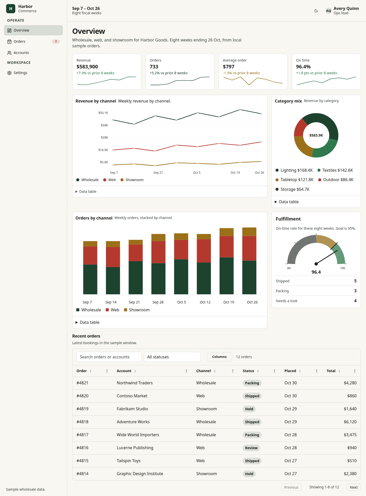
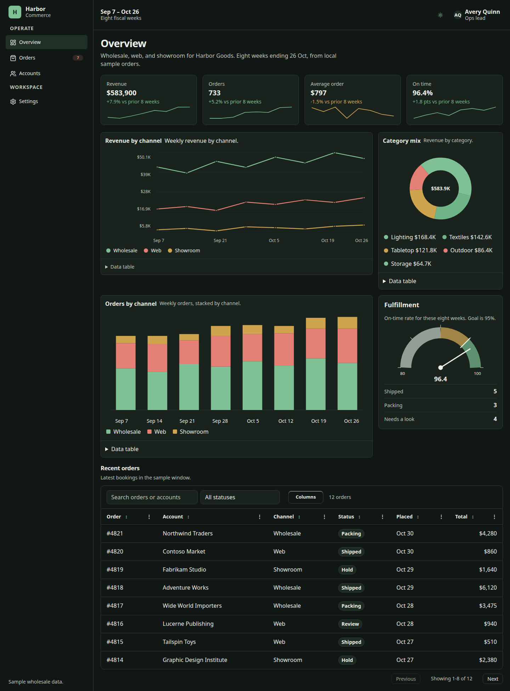

# Rowan Vite starter

Harbor is a one-page commerce dashboard: app shell, KPI cards with sparklines, a trend chart, a stacked bar chart, a donut chart, and a filterable orders table. It installs `@rowan-ui/core` and `@rowan-ui/icons` from npm. There is no framework.

[](https://stackblitz.com/github/2351Labs/rowan/tree/main/starters/vite)

The header theme button switches Rowan light and dark tokens. The orders table sorts from the column headers and filters from the toolbar search and status field. Figures are local sample data.





From a checkout of this folder:

```bash
npm install
npm run dev
```

Open http://127.0.0.1:5175/ . Inside the Rowan repo, `npm run dev --workspace=@rowan-ui/starter-vite` uses the local workspace copy of `@rowan-ui/core`. StackBlitz installs the published package.
